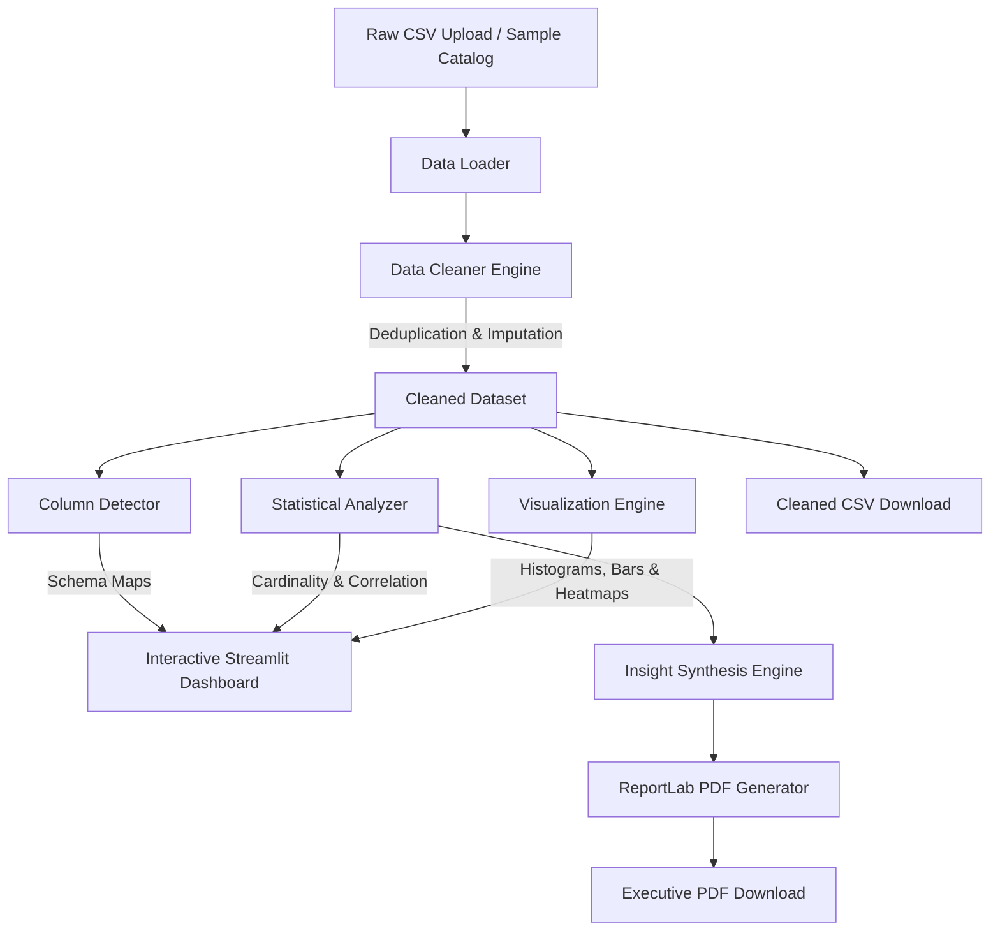
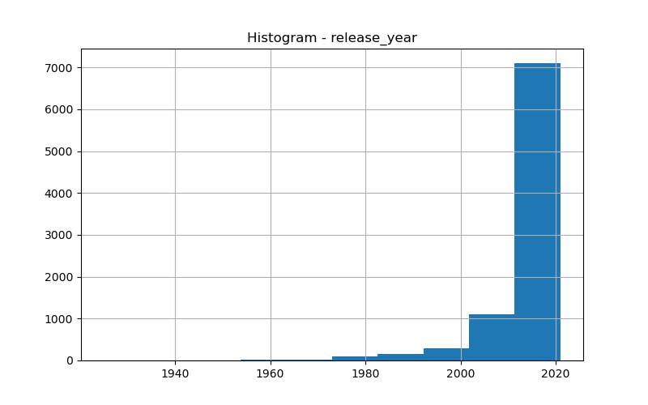
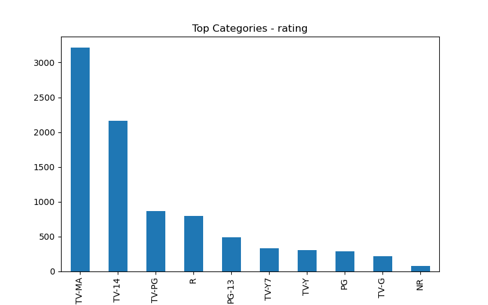
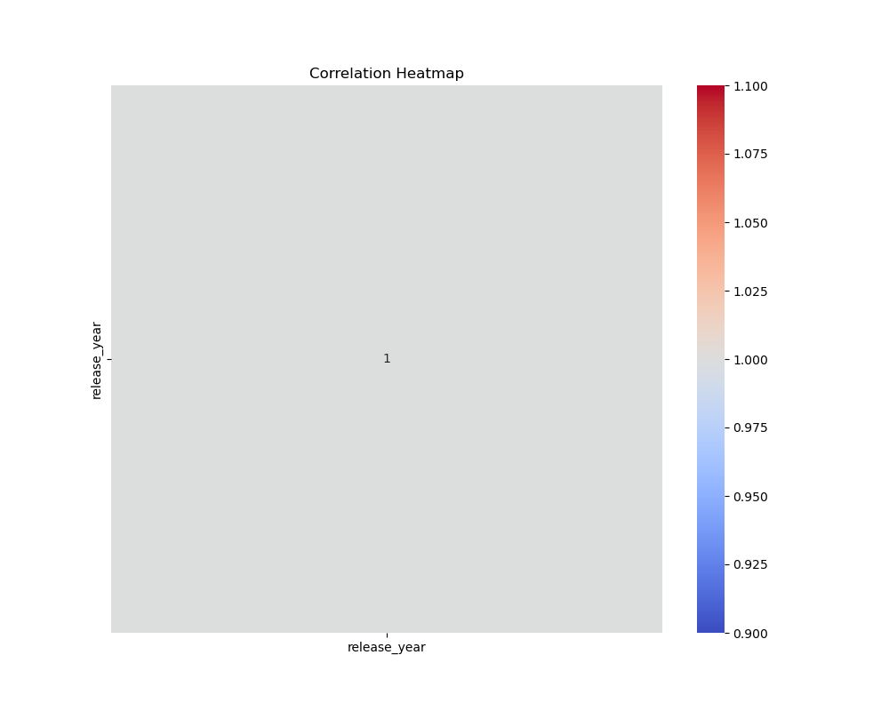

<div align="center">

# Universal CSV Analytics Platform

**Automated Exploratory Data Analysis (EDA), Intelligent Data Cleaning, Correlation Discovery, and Executive PDF Report Synthesis.**

[](app.py)
[](requirements.txt)
[](tests/test_analytics.py)
[](render.yaml)
[](LICENSE)

</div>

---

## 1. Executive Summary

The **Universal CSV Analytics Platform** is an open-source, automated data intelligence engine engineered to eliminate repetitive manual data wrangling and exploratory data analysis. Given any standard comma-separated tabular dataset, the platform autonomously executes a multi-stage data processing pipeline:
1. **Schema & Type Inference:** Distinguishes numerical from categorical dimensions.
2. **Automated Data Cleaning:** Eliminates duplicate rows, prunes completely empty columns, and applies robust statistical imputation.
3. **Statistical Analysis:** Computes global cardinality metrics, missingness profiles, and cross-variable Pearson correlation matrices.
4. **Visual Synthesis:** Generates high-resolution univariate distributions, categorical frequency charts, and annotated correlation heatmaps.
5. **Executive Reporting:** Synthesizes structured insights and compiles a camera-ready PDF summary document using ReportLab.

---

## 2. End-to-End Architecture



---

## 3. Statistical & Cleaning Methodology

### Robust Imputation Strategy
- **Numeric Features:** Imputed using the sample median $\tilde{x} = \text{median}(X)$, preserving central tendency against heavy-tailed outliers.
- **Categorical Features:** Imputed using the empirical mode $\text{mode}(X) = \arg\max_k f(k)$.
- **Degenerate Dimensions:** Columns with $100\%$ null values are safely purged to avoid numerical instability.
- **Row Identity:** Exact duplicate records are pruned in a single pass.

### Correlation Computation
Linear dependencies across numerical dimensions are quantified via the Pearson correlation coefficient:

$$r_{xy} = \frac{\sum_{i=1}^{n} (x_i - \bar{x})(y_i - \bar{y})}{\sqrt{\sum_{i=1}^{n} (x_i - \bar{x})^2} \sqrt{\sum_{i=1}^{n} (y_i - \bar{y})^2}}$$

---

## 4. Feature Showcase & Generated Outputs

The platform produces high-fidelity visual representations saved to `outputs/charts/` and rendered natively in the user interface:

| Distribution Histogram | Categorical Bar Chart | Correlation Heatmap |
| :---: | :---: | :---: |
|  |  |  |
| *Kernel density and frequency of numeric features* | *Top-10 category breakdown for discrete columns* | *Full cross-variable correlation matrix* |

---

## 5. Quickstart & Local Installation

### Prerequisites
- Python 3.10, 3.11, or 3.12
- Git

### 1. Clone & Set Up Virtual Environment
```bash
git clone https://github.com/purnachandra-maharana/universal-csv-analytics-platform.git
cd universal-csv-analytics-platform

# Create virtual environment
python -m venv venv

# Activate virtual environment
# Windows:
venv\Scripts\activate
# macOS / Linux:
source venv/bin/activate

# Install dependencies
pip install -r requirements.txt
```

### 2. Launch Streamlit Application
```bash
streamlit run app.py
```
Open your browser at `http://localhost:8501`. You can either upload your own CSV file or toggle **"Use Demo Dataset"** in the sidebar to test immediately with the bundled dataset.

---

## 6. Automated Testing Suite

The repository includes a comprehensive Pytest test suite covering all core analytical modules:

```bash
pytest tests -v
```

### Verified Test Matrix:
- `test_load_csv`: Validates CSV parsing and DataFrame shape integrity.
- `test_clean_dataset`: Verifies duplicate row removal, all-null column pruning, and median/mode imputation.
- `test_detect_columns`: Confirms accurate numeric vs. categorical schema separation.
- `test_dataset_summary`: Validates row, column, null, and duplicate counts.
- `test_missing_values`: Ensures descending missingness calculation accuracy.
- `test_correlation_matrix`: Validates Pearson correlation calculation on controlled inputs.
- `test_generate_insights`: Verifies dynamic insight generation formatting.
- `test_create_pdf_report`: Verifies ReportLab document generation and PDF file compilation.
- `test_generate_visualizations`: Confirms chart creation for numeric histograms, category bars, and heatmaps.

**Result: 9 passed in 5.55s.**

---

## 7. Cloud Deployment (Render Blueprint)

This repository includes an Infrastructure-as-Code manifest (`render.yaml`) optimized for zero-configuration deployment as a **Render Web Service**.

### Deploying to Render
1. Fork or push this repository to GitHub.
2. In the [Render Dashboard](https://dashboard.render.com), click **New +** > **Blueprint**.
3. Select this repository. Render will automatically parse `render.yaml` and configure:
   - **Service Type:** Web Service (Python)
   - **Build Command:** `pip install -r requirements.txt`
   - **Start Command:** `streamlit run app.py --server.port $PORT --server.address 0.0.0.0 --server.headless true`
   - **Health Check Path:** `/_stcore/health`

---

## 8. Repository Structure

```
universal-csv-analytics-platform/
├── .github/
│   └── workflows/
│       └── ci.yml               # Automated Pytest CI matrix across Python 3.10-3.12
├── data/
│   └── sample_dataset.csv       # Bundled sample dataset for instant evaluation
├── images/                      # Pre-generated sample visual analytics charts
│   ├── heatmap.png
│   ├── rating_bar.png
│   └── release_year_histogram.png
├── outputs/                     # Runtime output targets
│   ├── charts/                  # Dynamically generated distribution plots
│   ├── cleaned_data/            # Normalized CSV exports
│   └── reports/                 # Synthesized PDF documents
├── src/
│   ├── __init__.py
│   ├── analyzer.py              # Statistical summaries & correlation engine
│   ├── cleaner.py               # Missing value imputation & deduplication
│   ├── detector.py              # Column type classifier
│   ├── insight_generator.py     # Automated insight heuristics
│   ├── loader.py                # CSV ingestion handler
│   ├── report_generator.py      # ReportLab PDF synthesis
│   └── visualizer.py            # Matplotlib & Seaborn chart generator
├── tests/
│   ├── conftest.py              # Pytest sys.path bootstrap
│   └── test_analytics.py        # 9 unit & integration tests
├── app.py                       # Main Streamlit web application
├── render.yaml                  # Render Web Service blueprint
├── requirements.txt             # Production & development dependencies
└── README.md                    # Startup-grade technical documentation
```

---

## 9. Security & Privacy Disclosure

- **Ephemeral Storage:** Uploaded files and generated charts are stored in the local session execution directory (`outputs/`) and are discarded upon container restart.
- **Zero Third-Party Telemetry:** Streamlit usage statistics reporting is disabled (`STREAMLIT_BROWSER_GATHER_USAGE_STATS=false`).
- **No External Data Exfiltration:** All computations, cleaning, visualization, and PDF generation execute 100% locally within the service container.

---

## 10. Author & Attribution

**Purna Chandra Maharana**
- Portfolio: [github.com/purnachandra-maharana](https://github.com/purnachandra-maharana)
- Reference Standard: [Inkloom AI](https://github.com/purnachandra-maharana/inkloom-ai)
